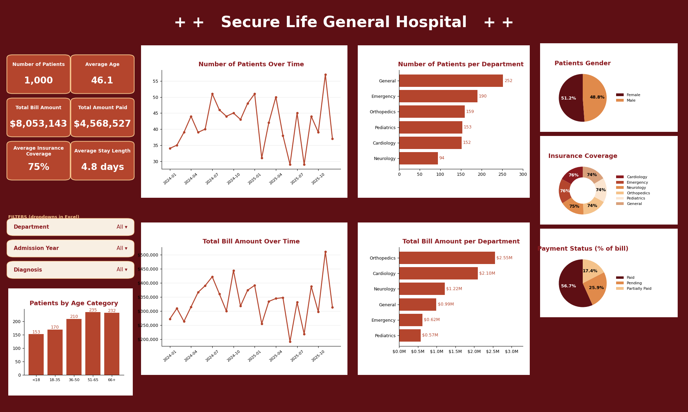

# Secure Life General Hospital: Operational & Financial Performance Dashboard

**Tool used:** Microsoft Excel (COUNTIFS, SUMIFS, AVERAGEIFS, calculated columns, charts, dropdown filters for Department, Year and Diagnosis)

---

## Introduction

Hospitals generate large volumes of admission, billing and insurance data, but without a consolidated view it is hard to see where patients are going, where revenue comes from and where money is being left uncollected. This project turns raw patient-visit records from Secure Life General Hospital into an interactive Excel dashboard that management can use to monitor operational performance, track payments and support decisions.

The analysis covers **1,000 patient visits between January 2024 and December 2025** and answers ten management questions on visits, billing, length of stay, payment status, insurance coverage, age groups and trends over time.

## About the Dataset

The dataset contains one row per patient visit (not per unique patient), so the same person can appear more than once. There are 1,000 records (PAT-3001 to PAT-4000) and 11 fields.

| Field | Description |
|---|---|
| Patient ID | Unique ID for each visit record |
| Patient Name | Name of the patient |
| Age / Gender | Patient age in years and recorded gender |
| Admission / Discharge Date | Dates the patient was admitted and discharged |
| Department | Cardiology, Emergency, General, Neurology, Orthopedics or Pediatrics |
| Diagnosis | Medical condition recorded (38 different diagnoses) |
| Total Bill Amount | Total amount charged for treatment and services |
| Insurance Coverage (%) | Share of the bill covered by insurance |
| Payment Status | Paid, Pending or Partially Paid |

### Data preparation
- The source PDF split each record into two blocks (patient details, then diagnosis and billing). I re-joined them by row order to rebuild all 1,000 complete records.
- Checks: 1,000 unique Patient IDs, no missing values, no discharge date earlier than admission date.
- Calculated columns added: Length of Stay, Age Group (Under 18, 18-35, 36-50, 51-65, 66+), Admission Year, Admission Month, Paid Amount and Outstanding Amount.
- **Paid Amount** = bill total for visits marked Paid. **Outstanding Amount** = bill total for visits marked Pending or Partially Paid. The data does not show how much a Partially Paid patient has already paid, so outstanding is an upper-bound estimate.

## Problem Statement

Management at Secure Life General Hospital has noticed changes in patient admissions, outstanding medical bills and insurance coverage across departments, but lacks a consolidated report showing operational and financial performance. As the data analyst, my task was to transform the raw data into insights and build an interactive dashboard that helps management monitor performance and make informed decisions, answering these questions:

1. How many patient visits has the hospital recorded?
2. Which departments receive the most patients?
3. Which departments generate the highest total bills?
4. What is the average length of stay by department?
5. What proportion of bills is paid, pending or partially paid?
6. How much has been billed and how much remains outstanding?
7. How does insurance coverage vary across departments and diagnoses?
8. Which age groups account for the most visits?
9. How do admissions and billing change over time?
10. Which areas may need management attention?

## Visualization

## Insights

### 1. Visit volume
The hospital recorded **1,000 patient visits** (508 in 2024 and 492 in 2025). Monthly admissions ranged from 29 to 57, peaking in November 2025 (57), with low points in February, June and August 2025. The average patient age is 46.1, and 51.2% of visits are female versus 48.8% male.

### 2. Departments by patient numbers
General is the busiest department with **252 visits (25.2%)**, followed by Emergency (190), Orthopedics (159), Pediatrics (153) and Cardiology (152). Neurology is the smallest with 94 visits (9.4%).

### 3. Departments by billing
Volume and revenue tell different stories. **Orthopedics generates the most billing ($2.55M, 31.7%)** despite being only third in visits, and Cardiology follows with $2.10M (26.0%). Together they produce 58% of all billing from just 31% of visits. General, the busiest department, accounts for only $0.99M because its average bill is about $3,900, compared with $16,062 in Orthopedics and $13,786 in Cardiology.

| Department | Visits | Total Billed | Avg Bill / Visit | Avg Stay (days) | Outstanding % |
|---|---|---|---|---|---|
| Orthopedics | 159 | $2,553,862 | $16,062 | 8.4 | 42.9% |
| Cardiology | 152 | $2,095,438 | $13,786 | 6.5 | 42.8% |
| Neurology | 94 | $1,215,303 | $12,929 | 6.9 | 40.1% |
| General | 252 | $993,027 | $3,941 | 3.9 | 49.6% |
| Emergency | 190 | $622,525 | $3,276 | 2.0 | 40.3% |
| Pediatrics | 153 | $572,988 | $3,745 | 3.0 | 45.4% |

### 4. Length of stay
The average stay is **4.8 days**. Orthopedics (8.4 days), Neurology (6.9) and Cardiology (6.5) keep patients longest, while Emergency has the shortest stays (2.0 days). About 10% of visits (101) lasted 10 days or more.

### 5. Payment status
By billed amount, **56.7% is Paid, 17.4% Partially Paid and 25.9% Pending**. By visit count the split is 56.4%, 17.9% and 25.7%.

### 6. Billed versus outstanding
The hospital billed **$8,053,143**. Of this, $4,568,527 (56.7%) has been paid, leaving up to **$3,484,616 (43.3%) outstanding**: $2,082,786 pending and $1,401,830 partially paid. Orthopedics ($1.10M) and Cardiology ($0.90M) hold over half of the outstanding balance. 129 high-value visits (bills above $10,000) with unpaid balances account for about $2.17M, or 62% of everything outstanding.

### 7. Insurance coverage
Average coverage is **74.9%** and is fairly even across departments, from 73.9% in General to 76.3% in Cardiology. Differences by diagnosis are larger: coverage is highest for Coronary Artery Disease (82.9%), Stroke (82.2%) and RSV (80.8%), and lowest for Asthma (61.5%), Arrhythmia (63.5%) and Epilepsy (67.9%). 44 visits (4.4%) had no insurance coverage at all, totalling $345,195 in bills.

### 8. Age groups and gender
Visits rise with age: **51-65 (235) and 66+ (232)** are the largest groups, followed by 36-50 (210), 18-35 (170) and Under 18 (153). Patients aged 51 and above make up 46.7% of visits and 54% of billing, and the 51-65 group has the highest average bill ($10,028). Gender is almost evenly split: **51.2% female (512 visits) and 48.8% male (488 visits)**.

### 9. Trends over time
Admissions and billing rose through 2024 (quarterly visits grew from 108 in Q1 to 141 in Q3), dipped in the first half of 2025, then recovered strongly in Q4 2025 (133 visits, $1.12M billed). Full-year billing was $4.13M in 2024 and $3.92M in 2025 (down 5%). The outstanding share of billing was lower in 2025 (40.3%) than 2024 (46.1%), though recent bills naturally have had less time to be paid.

### 10. Billing drivers by diagnosis
Carpal Tunnel is the largest billing diagnosis ($589,740 across 37 visits), followed by Atrial Fibrillation ($546,653), Knee Replacement ($494,615, the highest average bill at about $18,300) and Spinal Disc Herniation ($448,637). Carpal Tunnel also has the biggest unpaid balance ($336,642, 57% of its billing).

## Recommendation

- **Target high-value balances.** Focus collections on Orthopedics and Cardiology, which hold over half of the outstanding balance, and prioritise the 129 high-value unpaid bills.
- **Fix collection gaps in General and Pediatrics.** General has the highest outstanding rate (49.6%) and Pediatrics the highest pending share (28.8% of visits). Review billing follow-up and payment-plan processes in both.
- **Reduce unpaid balances on costly procedures.** Offer instalment plans, early reminders and insurance pre-authorisation for procedures such as Knee Replacement, Carpal Tunnel and Spinal Disc Herniation.
- **Improve insurance support.** Support the 44 uninsured visits with financial counselling, and help patients with lower-coverage conditions (Asthma, Arrhythmia, Epilepsy) understand out-of-pocket costs before treatment.
- **Manage length of stay.** Orthopedics, Neurology and Cardiology have the longest stays. Review discharge planning and bed management to free capacity without hurting care quality.
- **Plan capacity around demand.** Plan staffing and beds around peak months and the growing 51+ patient groups, and investigate the 2025 dips to see whether they were caused by capacity, referrals or data gaps.

## Conclusion

The dashboard shows a hospital with steady demand, led in volume by General and Emergency but led in revenue by Orthopedics and Cardiology. Insurance coverage is healthy at about 75% on average, yet 43% of the amount billed is still unpaid, which is the biggest financial risk identified. Concentrating collection efforts on high-value bills and on the departments with the weakest payment performance is the quickest way to improve cash flow, while length-of-stay and demand data can guide capacity planning.

*Limitations: the data has no record of amounts actually paid on partially paid bills, no payment dates, and no unique patient identifier beyond name, so outstanding figures are estimates and repeat-visit analysis is not possible.*

## Project Files

| File | Description |
|---|---|
| `Hospital_Patients_Analysis.xlsx` | Dataset, formula-driven analysis tables and dashboard |
| `Dashboard_Image.png` | Screenshot of the dashboard |
| `Introductory_Image.png` | Project banner |
| `README.md` | Project documentation (this file) |
